# Painter Quote

Photo and description to a professional painting quote in under a minute.

AI assisted estimating for residential painting contractors running 1 to 10 person
businesses. It owns exactly one workflow, job info to scope to price to quote, and does not
try to be a contractor management platform.

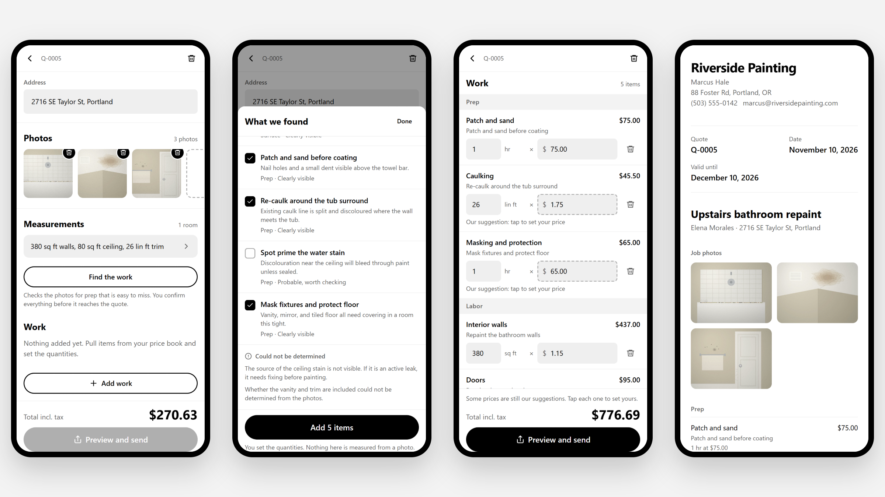

## Demo

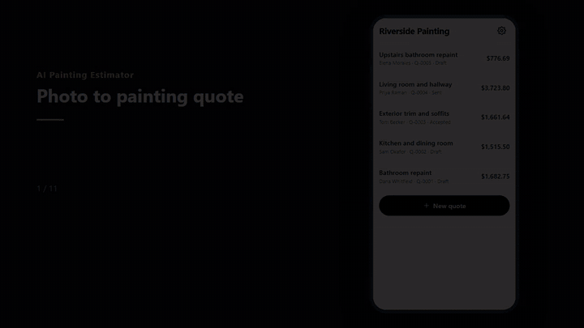

A 76-second walkthrough, from job photos to the quote the customer opens. Recorded locally in
`DEMO_MODE=1`, so the AI step returns a sample result. The photos are illustrated stand-ins
and the business and customers are made up.

## How it works

The painter is standing in the customer's house with a phone. Everything below is that one
flow, start to finish.

### 1. Snap the job

<table>
<tr>
<td valign="top">
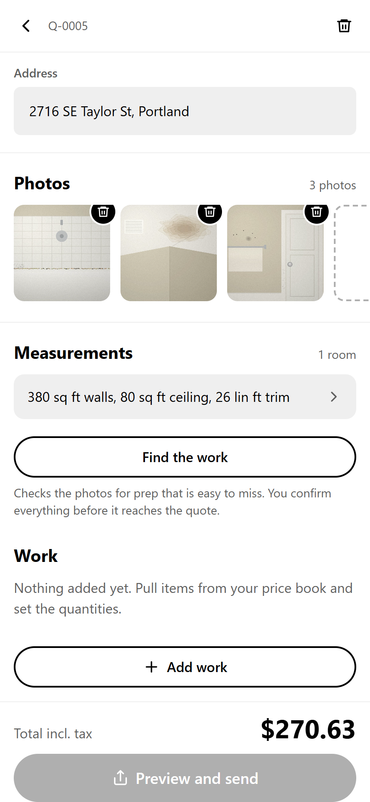
</td>
<td valign="top">

Add a few photos from the rear camera and pick the room size. Photos are resized on the
phone to 1024px before upload, because the painter is usually on a truck's cell connection.

Room size is two taps from a preset list, or length by width by height. **The AI never
measures from a photo.** An uncalibrated phone camera can't give reliable square footage,
and area is the number that sets the price.

Then tap **Find the work**.

</td>
</tr>
</table>

### 2. The AI catches the prep you would forget to charge for

<table>
<tr>
<td valign="top">
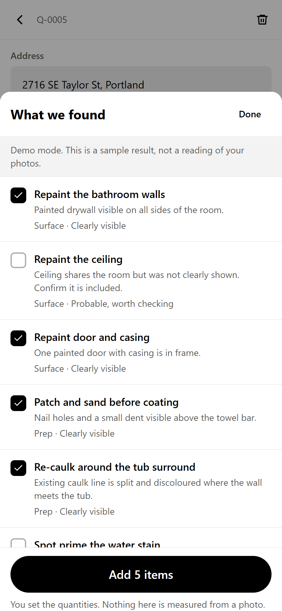
</td>
<td valign="top">
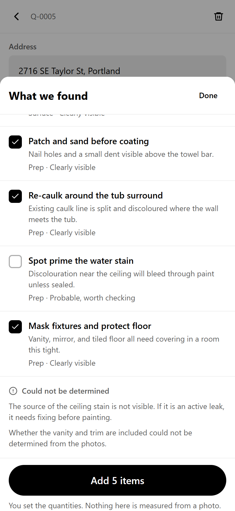
</td>
</tr>
</table>

This is the product. Painters lose money on prep they don't bill for: the split caulk line
at the tub, the water stain that will bleed through new paint, the nail holes by the towel
bar. The vision model returns surfaces, conditions and prep, each with the reason it was
flagged.

Only high-confidence findings start checked. Anything the model is unsure about, like
spot-priming the stain above, takes a deliberate tap, so nothing uncertain reaches a
customer's quote by default. It also says what it **could not** determine, such as whether
that stain is an active leak.

### 3. Measurements fill in the quantities

<table>
<tr>
<td valign="top">
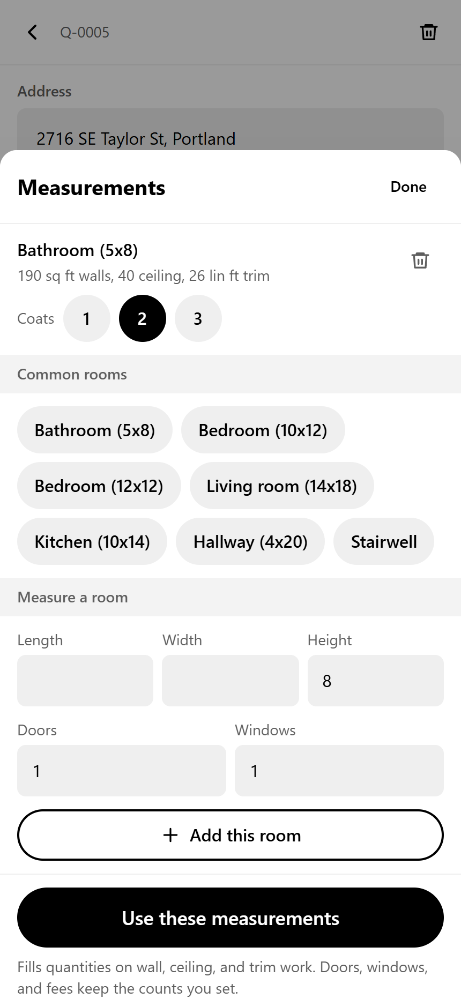
</td>
<td valign="top">

Rooms fan out across the quote: wall area drives wall painting, priming and wallpaper
removal, trim length drives trim and caulking, and coats multiply in. Doors, windows and
flat fees keep the counts the painter set.

This overwrites quantities, so it's an explicit button rather than something that happens
silently whenever a room changes.

</td>
</tr>
</table>

### 4. Confirm the prices. The price book fills itself in

<table>
<tr>
<td valign="top">
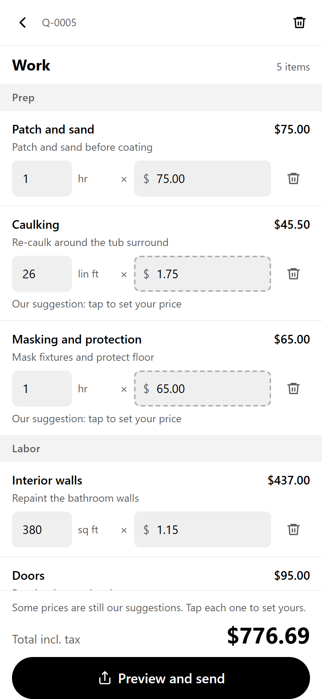
</td>
<td valign="top">
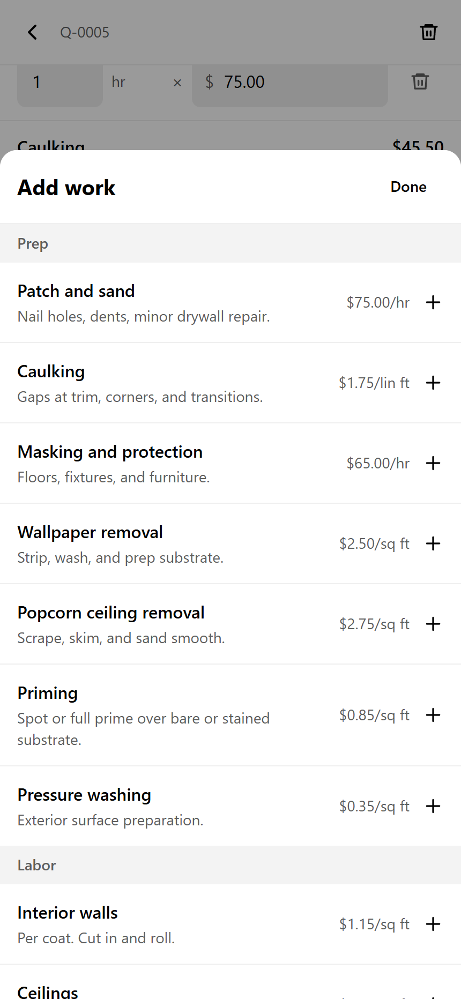
</td>
</tr>
</table>

A new account starts with a seeded price book, so a painter can send a complete quote on
day one without typing in forty line items first. **The AI never sets a price.** A seeded
rate shows with a dashed border and *"Our suggestion: tap to set your price."* Editing it
confirms the line and saves the number to that painter's price book, so they never get
asked again.

The total updates live as you type. It's computed by the same `shared/pricing.ts` module
the server uses, so the editor and the sent quote can't disagree. Edits autosave, so there's
no Save button to forget mid-conversation.

### 5. Send a link. The customer opens a real document

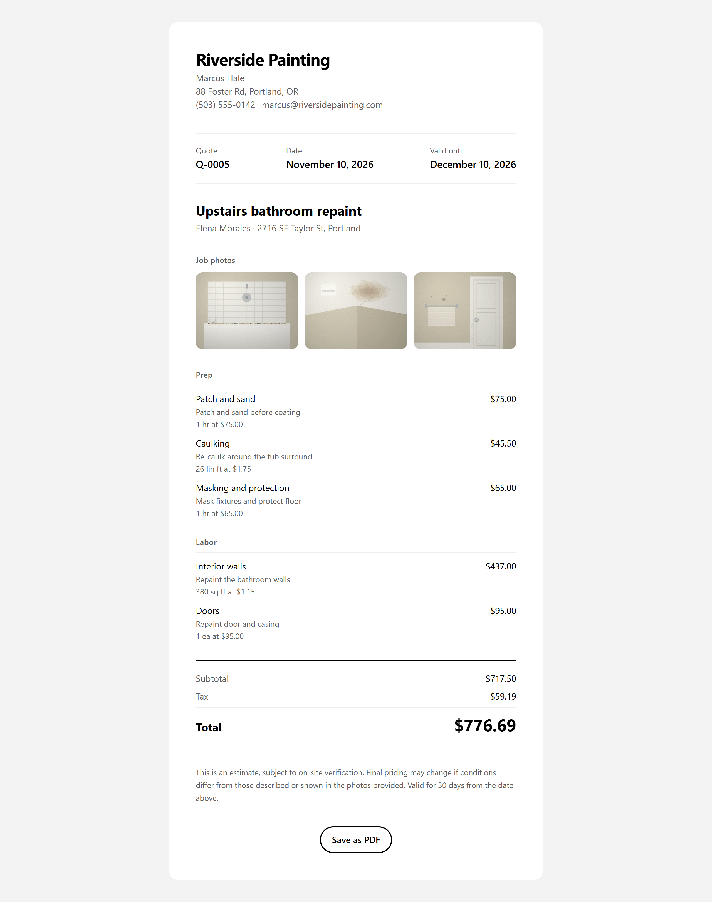

<table>
<tr>
<td valign="top">
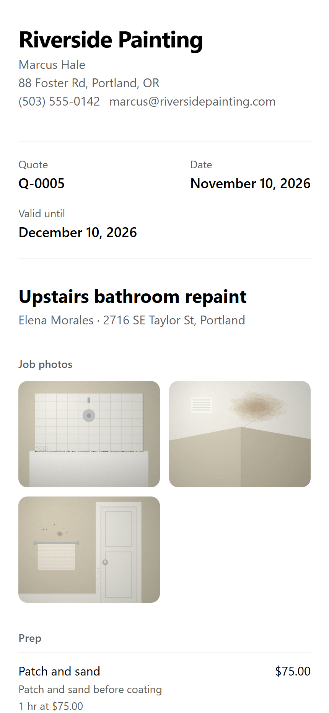
</td>
<td valign="top">
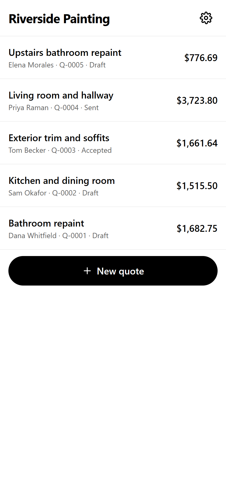
</td>
</tr>
</table>

**Preview and send** opens the phone's share sheet with a short `/q/…` link to paste into a
text message. The customer gets a quote that reads like something a real business sent:
itemized, with tabular figures so the price column lines up, and the *"estimate, subject to
on-site verification"* terms every quote carries. It needs no sign-in, and it saves to PDF.

The home screen lists every quote with its status and total.

> These screenshots come from a local run in `DEMO_MODE=1`, which is why the AI sheet says
> it's showing a sample result. The job photos are illustrated stand-ins, and the business
> and customers are made up.

## What it actually sells

Not "an app that formats your quote nicely." Painters lose money by **under scoping prep**:
wallpaper that has to come off, popcorn ceiling, water damage behind a stain, a stairwell
that needs staging, trim that needs caulk before it can be coated. Those are the line items
that get forgotten, and each one is real margin.

The product is a checklist that catches what you would forget to charge for.

## Two rules that shape everything

**The AI never estimates square footage from a photo.** A vision model cannot measure
reliably from an uncalibrated phone camera, and area is the number that sets the price. The
AI supplies surfaces, condition, and prep flags. The contractor supplies dimensions. A
deterministic engine does the arithmetic.

**The AI never sets a final price.** Seeded rates render as clearly marked suggestions that
the contractor confirms, and every confirmation writes back to their price book. A new user
can produce a complete quote on day one without first entering forty line items, and the
price book fills itself in through use.

## Stack

| Layer | Choice |
| --- | --- |
| Client | React, Vite, TypeScript, Tailwind, PWA |
| Platform | Cloudflare Workers |
| Framework | Hono |
| Database | Cloudflare D1 |
| Object storage | Cloudflare R2 |
| Vision | Gemini Flash behind an adapter |

Cloudflare throughout because its free tier permits commercial use and has no cold starts.
Running cost is zero until there is revenue.

## Running it

```bash
npm install
npx wrangler d1 migrations apply painter-quote --local
npm run dev
```

`npm run dev` starts Vite and the Worker together on one origin against the real workerd
runtime, so bindings behave as they do in production. No separate wrangler process.

`DEMO_MODE=1` (the default) stubs the vision call, so the whole UI runs with no API key, no
quota burn, and no network.

```bash
npm test          # pricing engine
npx tsc -b        # typecheck client and worker projects
npm run build
```

## Money

Stored as integer cents, and tax as integer basis points, everywhere. Binary floating point
cannot represent 0.1 exactly and a quote is a document someone pays against.

`src/shared/pricing.ts` is the single definition of what a quote costs. It sits in `shared`
rather than `server` because the editor computes live totals from the same code, and two
implementations of money math would eventually give two answers.

## Status

Photo to quote works end to end: capture job photos, let the AI find the work, confirm what
applies, set quantities and prices, share a link, and the customer opens a real document.

Sign-in is by magic link, with no password to choose or forget. While `DEMO_MODE=1` an
unauthenticated visitor falls back to a shared demo account, so a painter can still be
handed a phone during validation with nothing in the way.

`DEMO_MODE=1` is also the default for the AI step, which returns a realistic sample rather
than calling a model, so a demo never depends on a live API call.

See the [open issues](https://github.com/Relatora/painter-quote/issues) for what is next.

## License

Copyright (c) 2026 Amr Abdallah. All rights reserved.

The source is public to read, not to use. You may view it to evaluate my work, but you may not run, copy, modify, redistribute or train AI models on it. See [LICENSE](LICENSE) for the full terms.
